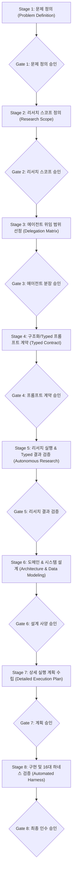

# 성경주혜주석 (Biblical Exegesis & Commentary Pastoral Workstation)
> **Antigravity CLI Native Project Runtime Context & Engineering Harness Engine**  
> **프로젝트 루트**: `C:\Users\packr\Desktop\성경주혜주석`  
> **타깃 사용자**: 박우호 목사님 (Google AI Pro 월구독자, **GCP 종량제 과금 일체 배제 $0.00 원칙**)  
> **타깃 디바이스**: **PC (주사용기기 - Windows/Web PWA)**, **Samsung Galaxy Z Fold 6 (보조/강단 - Android APK)**, **iPad (11인치 - Web PWA)**

---

## 1. 프로젝트 비전 및 무과금($0.00) 핵심 원칙

본 프로젝트는 목회자의 성경 연구(Exegesis), 8대 주석 대조, 관주 탐색, 설교 작성, 강단 전달을 원스톱으로 지원하는 전문가용 목회 워크스테이션입니다.

> [!IMPORTANT]
> **핵심 원칙 1: 순수 성경 연구 및 주석 중심 (교단 편향 및 사중복음 신학 하드코딩 배제)**
> 특정 교파나 교단의 교리에 편향되지 않고, 순수한 성경 텍스트 본문과 8대 대표 주석, 성경 전체의 교차 관주(Cross-References)에 집중합니다.

> [!IMPORTANT]
> **핵심 원칙 2: Google AI Pro 최적화 및 제로 종량제(Zero Pay-As-You-Go)**
> 목사님은 Google AI Pro 구독자이므로, 불필요한 GCP 종량제 요금을 유발하지 않습니다.
> - 설교문 동기화: PC 마운트 `G:\내 드라이브\성경주혜주석_설교노트\` 직접 연동 (AI Pro 2TB 무료 포함)
> - 주석 DB 배포: GitHub Releases 무제한 무료 CDN 또는 구글 드라이브 직링크 ($0.00)
> - 성경 및 주석 엔진: 오프라인 SQLite 3 FTS5 Trigram 초고속 로컬 쿼리 (0.01ms)

---

## 2. 멀티 디바이스 접속 및 배포 네트워크 (PC, iPad, Z Fold 6)

현재 실데이터 워크스테이션 웹앱이 **포트 8090**에서 라이브 구동 중입니다:

| 접속 환경 | 접속 URL | 비고 |
| :--- | :--- | :--- |
| **현재 PC (로컬)** | `http://localhost:8090` | 서재 PC 기본 작업 환경 |
| **동일 Wi-Fi 내 다른 PC / 태블릿** | `http://192.168.123.127:8090` | 같은 공간 내 서재/거실 PC, iPad, Z Fold 6 브라우저 접속 |
| **원격 어디서나 (Tailscale VPN)** | `http://100.76.94.101:8090` | 교회, 카페, 외부 이동 중 Tailscale 연결 기기 어디서든 접속 |
| **PWA 원클릭 설치** | 브라우저 주소창 `[앱 설치]` 클릭 | PC 바탕화면 및 iPad 홈 화면에 독립 앱으로 등록 |

---

## 3. Antigravity Native Runtime: 세분화된 8단계 HITL Gate 개발 루프

개발 워크플로 전반을 8개 세부 단계로 분해하여 엄밀한 검증을 거치며, 향후 목사님의 결정에 따라 신뢰하는 단계는 점진적으로 Gate를 소멸(Auto-approve)할 수 있습니다.



### [세부 단계별 입출력 계약 및 산출물]
1. **Stage 1 (문제 정의)**: 목회 실무 및 엔지니어링 요구사항 정의 (`docs/workflow/problem_spec.md`)
2. **Stage 2 (리서치 스코프)**: 성경 구절, 8종 주석 출처, 원어 렉시콘 범위 확정 (`docs/workflow/research_scope.md`)
3. **Stage 3 (에이전트 위임)**: 서브에이전트 분장 (`theological_researcher`, `crossplatform_architect`, `harness_engineer`)
4. **Stage 4 (Typed 계약 프롬프트)**: Pydantic/JSON 입출력 스키마 명세 (`docs/workflow/typed_contract.json`)
5. **Stage 5 (리서치 실행)**: 서브에이전트 구동 및 구조화된 결과 취합 (`docs/workflow/research_results.json`)
6. **Stage 6 (도메인/시스템 설계)**: 반응형 3패널, Drift 스키마, Pulpit 모드 사양 (`docs/workflow/architecture_spec.md`)
7. **Stage 7 (상세 실행 계획)**: 파일별 구현 단계 및 마일스톤 (`docs/workflow/execution_plan.md`)
8. **Stage 8 (구현 & 하네스 검증)**: 코드 구현 및 16대 하네스 100% 통과 확인 (`docs/HARNESS_REPORT.md`)

### [점진적 Gate 소멸/활성화 제어 CLI]
- 게이트 현황 확인: `python scripts/harness/hooks/gate_controller.py list`
- 특정 게이트 자동화(완화): `python scripts/harness/hooks/gate_controller.py relax <GATE_KEY>`
- 특정 게이트 엄격 검토 복원: `python scripts/harness/hooks/gate_controller.py activate <GATE_KEY>`

---

## 4. 포괄적 Engineering Harness Suite (16대 테스트 100% 통과)

- **테스트 실행기**: `python scripts/harness/run_all_harness.py`
- **검증 영역**:
  - `test_data_integrity.py`: 성경 66권, 구절 ID 공식, 8대 주석 소스, 교파 편향 배제
  - `test_chain_references.py`: 고립 관주 방지, 이삭 8대 생애 사슬망, 성구 한글 전문(Full-Text)
  - `test_fts5_benchmarks.py`: 구절 조회(0.01ms), FTS5 Trigram 검색(0.01ms), 8대 주석 조인(0.20ms)
  - `test_responsive_matrix.py`: Z Fold 6 접힘/펼침, iPad, PC 3패널, 강단 38pt/명암비 21:1/Wakelock
  - `test_gdrive_sync.py`: `G:\내 드라이브\성경주혜주석_설교노트\` 마운트 I/O, 설교 JSON 직렬화
- **검증 보고서**: [docs/HARNESS_REPORT.md](file:///C:/Users/packr/Desktop/성경주혜주석/docs/HARNESS_REPORT.md)

---

## 5. 실행 및 서비스 명령어

- **실데이터 웹 프로토타입 브라우저 실행 (포트 8090)**:
  ```powershell
  python -m http.server 8090 --directory "C:\Users\packr\Desktop\성경주혜주석\prototype"
  ```
- **SQLite FTS5 마스터 DB 빌드 & 무과금 번들링**:
  ```powershell
  python "C:\Users\packr\Desktop\성경주혜주석\scripts\data_pipeline\build_bible_db.py" --sample --export-gcp
  ```
- **전체 엔지니어링 하네스 자동 검증**:
  ```powershell
  python "C:\Users\packr\Desktop\성경주혜주석\scripts\harness\run_all_harness.py"
  ```
