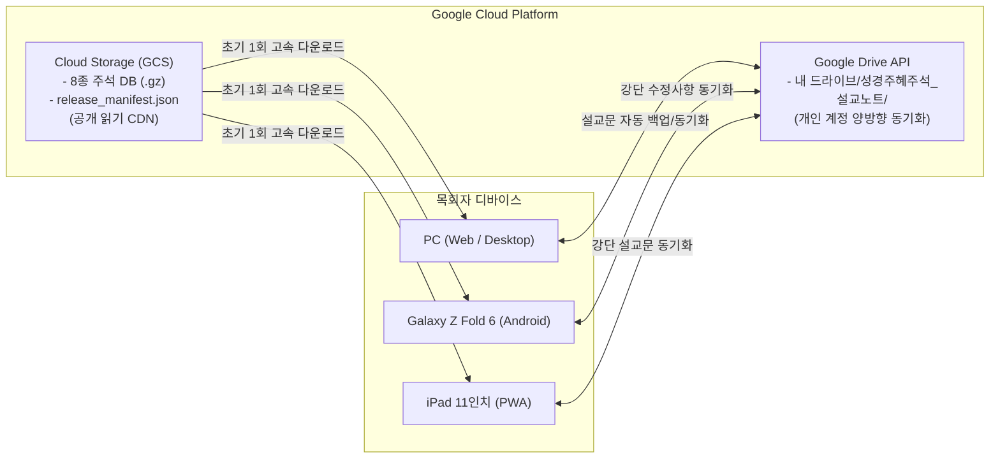

# Google Cloud Platform (GCP) 인프라 및 연동 명세서

> **프로젝트**: 성경주혜주석 (Biblical Exegesis & Commentary Pastoral Workstation)  
> **타깃 사용자**: 박우호 목사님  
> **적용 기기**: PC (주사용), Samsung Galaxy Z Fold 6 (보조), iPad 11인치 (보조)

---

## 1. 개요 및 GCP 아키텍처

본 워크스테이션은 8종 방대한 성경 주석 및 교차 관주 데이터를 안전하고 신속하게 배포하고, 목사님의 설교 원고를 개인 구글 드라이브와 실시간 동기화하기 위해 GCP 2대 서비스를 연동합니다.



---

## 2. Google Cloud Storage (GCS) 주석 배포 버킷 설정

### (1) 버킷 생성
- **권장 버킷 이름**: `pastoral-bible-commentaries` (또는 전 세계 고유한 이름 예: `bible-commentaries-pastor-pack`)
- **스토리지 클래스**: `Standard`
- **위치 유형**: `Region` -> `asia-northeast3 (서울)` (초저지연 고속 다운로드)
- **공개 액세스 방지(Public Access Prevention)**: **해제 (Enforce public access prevention 체크 해제)**

```bash
# gcloud CLI 명령어로 생성 시
gcloud storage buckets create gs://pastoral-bible-commentaries \
    --location=asia-northeast3 \
    --default-storage-class=STANDARD \
    --uniform-bucket-level-access
```

### (2) 웹앱(PWA/Web) 지원을 위한 CORS 설정 (중요!)
PC 웹앱 및 브라우저에서 GCS의 압축 DB를 직접 `fetch`할 수 있도록 CORS 정책을 적용해야 합니다.

**`cors.json` 파일 내용**:
```json
[
  {
    "origin": ["*"],
    "method": ["GET", "HEAD"],
    "responseHeader": ["Content-Type", "Content-Length", "ETag"],
    "maxAgeSeconds": 3600
  }
]
```

**CORS 적용 명령어**:
```bash
gcloud storage buckets update gs://pastoral-bible-commentaries --cors-file=cors.json
```

### (3) 공개 읽기(Public Read) 권한 부여 (HITL Gate 결정 사항)
앱 사용자가 별도의 API 키나 로그인 없이 8종 주석 마스터 DB를 즉시 다운로드할 수 있도록 `allUsers` 읽기 권한을 부여합니다.

```bash
gcloud storage buckets add-iam-policy-binding gs://pastoral-bible-commentaries \
    --member=allUsers \
    --role=roles/storage.objectViewer
```

### (4) 파일 업로드 구조
```
gs://pastoral-bible-commentaries/
└── v1/
    ├── release_manifest.json          # 최신 버전 정보, SHA256 체크섬, 파일 크기
    └── commentaries_master_v1.0.db.gz # Gzip 압축된 8종 주석 SQLite FTS5 마스터 DB
```

- **다운로드 엔드포인트 URL**:
  - 매니페스트: `https://storage.googleapis.com/pastoral-bible-commentaries/v1/release_manifest.json`
  - 주석 DB: `https://storage.googleapis.com/pastoral-bible-commentaries/v1/commentaries_master_v1.0.db.gz`

---

## 3. Google Drive API (설교 원고 개인 동기화) 설정

목사님이 PC에서 작성하신 설교문(3대지, 인용 구절, 주석 스크랩)이 모바일(Fold 6) 및 태블릿(iPad) 강단 모드와 실시간 양방향 동기화되도록 설정합니다.

### (1) GCP Console에서 API 활성화
1. [Google Cloud Console](https://console.cloud.google.com/) 접속
2. 프로젝트 선택 (예: `pastoral-bible-workstation`)
3. **[API 및 서비스]** -> **[라이브러리]** 이동
4. **"Google Drive API"** 검색 후 **[사용]** 버튼 클릭

### (2) OAuth 동의 화면 구성
1. **사용자 유형**: `외부 (External)` (또는 목사님 Google Workspace 도메인이 있다면 내부)
2. **앱 이름**: `성경주혜주석 워크스테이션`
3. **사용자 지원 이메일**: 목사님 이메일 지정
4. **범위(Scopes)** 추가:
   - `.../auth/drive.file` (**권장**: 앱이 생성한 설교 파일만 접근하므로 목사님의 개인적인 다른 드라이브 문서에는 일체 접근하지 않아 보안상 가장 안전합니다)

### (3) OAuth 2.0 클라이언트 ID 생성
1. **[사용자 인증 정보]** -> **[사용자 인증 정보 만들기]** -> **[OAuth 클라이언트 ID]**
2. **애플리케이션 유형**:
   - **웹 애플리케이션 (PC/Web/iPad용)**:
     - 승인된 자바스크립트 원본: `http://localhost:8090`, 배포 도메인
     - 승인된 리디렉션 URI: `http://localhost:8090/oauth2callback`
   - **Android (Galaxy Z Fold 6용)**:
     - 패키지 이름: `com.pastoral.bible_commentary`
     - SHA-1 인증서 지문: 디버그/릴리스 키스토어 지문 입력

---

## 4. 환경설정 상수 정의 (`lib/core/config/gcp_config.dart`)

```dart
class GcpConfig {
  // GCS 주석 배포 설정
  static const String gcsBucketName = "pastoral-bible-commentaries";
  static const String gcsBaseUrl = "https://storage.googleapis.com/$gcsBucketName/v1";
  static const String manifestUrl = "$gcsBaseUrl/release_manifest.json";
  static const String masterDbUrl = "$gcsBaseUrl/commentaries_master_v1.0.db.gz";
  
  // Google Drive 동기화 설정
  static const String gdriveFolderName = "성경주혜주석_설교노트";
  static const List<String> gdriveScopes = [
    "https://www.googleapis.com/auth/drive.file",
  ];
}
```
